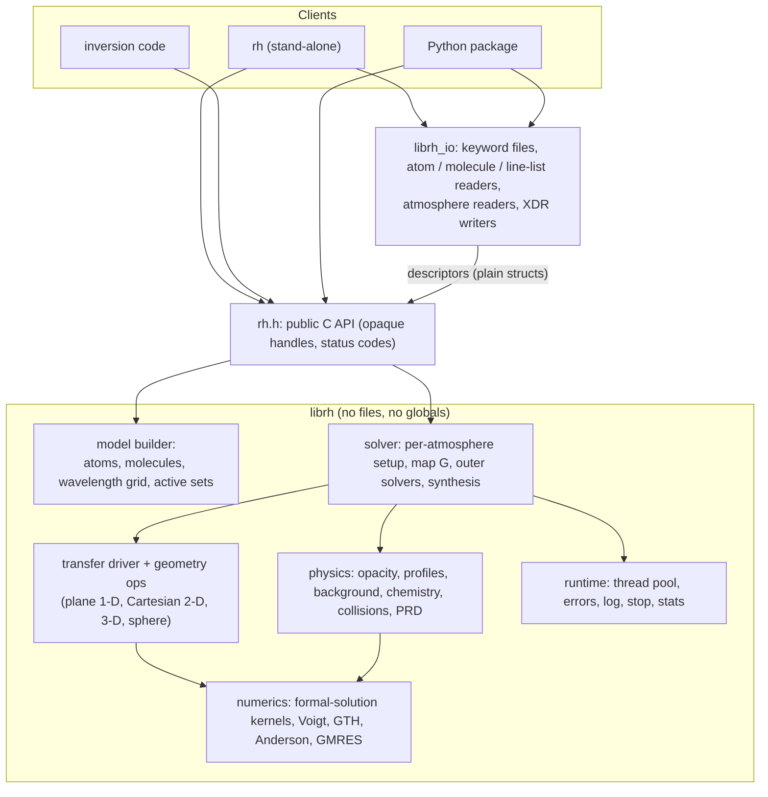
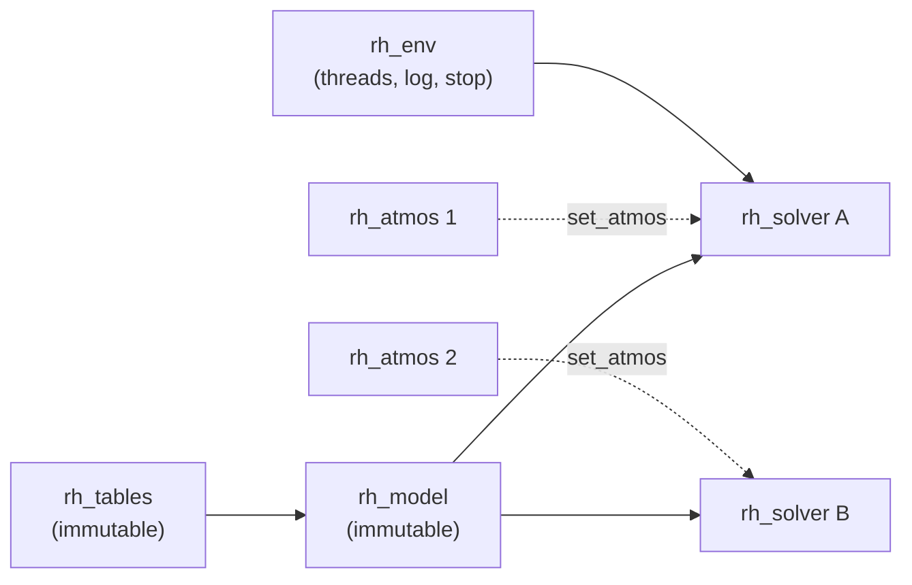
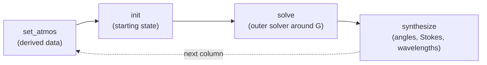
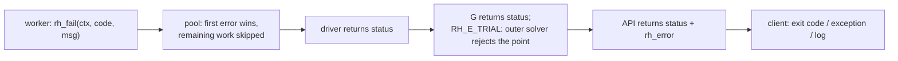
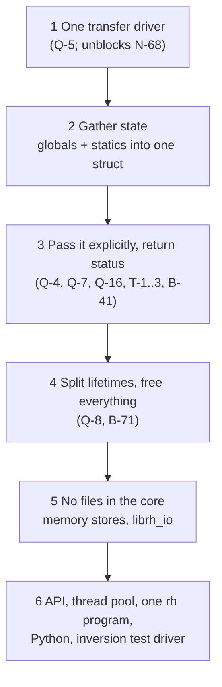

# RH as a library (library track)

Design document for turning RH from four monolithic programs into a library
that a stand-alone program, inversion codes and Python bindings all use. It
records the requirements, the target design, how the current code maps onto
it, and a migration plan that keeps every step verifiable.

- **Status:** proposal, 2026-11-23, for review. Written against `modernize`
  at `9885adb` (end of plan step 4). Statements about the current code come
  from a survey of that commit, spot-checked against the source; the
  evidence (survey notes, profile) is in
  `/hao/solar1/dwijn/claude/RH/evidence/lib-codemap-profile/`.
- **Companion pages:** the illustrated version of this document,
  <https://claude.ai/artifact/FgTtZN6epAUVuKwE8Si46T>, and the *RH code map*
  (how the code is put together today),
  <https://claude.ai/artifact/UXA2hsvfBEMVFQEzBCLPFW>.
- **Labels used below.** **Decided**: settled with the user. **Proposed**:
  the design as drafted here; changes on review. **Open**: undecided; the
  implementer reports options and measurements rather than choosing
  silently.
- **Decided (user, 2026-11-23):** the core stays in C. The library is
  agnostic of file formats and does not read or write files where it can be
  avoided. MPI stays out, at least for now. The design leaves room for
  response functions. The target design comes first; it may break with the
  current structure where there is a good reason, and the migration reuses
  what fits.

Contents: §1 the clients and what they need, §2 requirements, §3 the
design (objects, geometry, threads, errors, memory, derivatives), §4 the API
in outline, §5 how today's code maps onto it, §6 the migration plan, §7
breaking changes to decide, §8 open questions.

---

## 1. Three clients

| Client | Typical use | What it needs from RH |
|---|---|---|
| **Stand-alone program** (`rh`, today `rhf1d`, `rhsc2d`, `rhsc3d`, `rhsphere`) | One atmosphere per run, any geometry, input and output files in RH's formats | Every current configuration, with the results of the current programs; file formats handled outside the core |
| **Inversion codes** (STIC-like) | Thousands to millions of 1-D (1.5-D) syntheses per process, same atoms and wavelength grid, a different atmosphere each time; many columns at once on threads; response functions | Set up the atoms and the wavelength grid once; per column: new atmosphere, warm start, solve, emergent spectrum at the observed angles; a failing column returns an error and the process carries on |
| **Python bindings** | Interactive work and scripts: build or load an atmosphere, solve, inspect populations and J, change a keyword, solve again | Arrays in, arrays out; exceptions instead of exits; warnings into Python's logging; interrupt with Ctrl-C; no files left behind |

What the current code does against these needs (from the code map):

- The library defines no global variables, but every program defines eight
  (`atmos`, `spectrum`, `input`, `geometry`, `commandline`, `stats`,
  `messageStr`, `topology`) and the library uses seven of them through
  `extern`; about 60 file-level `static` variables hold the rest.
- About 600 call sites end the process with `exit(70)`.
- Atom arrays are sized with `Nspace` when the atom file is read, and
  `Background()` frees the passive atoms, partition functions and Kurucz
  lines halfway through a run. The wavelength grid depends on whether the
  atmosphere moves and whether it has a magnetic field. So atoms and grid
  cannot be reused for a second atmosphere.
- Nothing is freed at the end of a run (`freeAtmos` and `freeSpectrum` are
  never called), and several static arrays are sized by the first run and
  never reset. A second run in the same process would read stale data.
- Scratch data goes to fixed-name files in the current directory
  (background opacity, PRD weights, `Jgas.dat`, `Imu.dat`), which are never
  removed.
- The four programs each carry a copy of the per-wavelength driver
  `Formal()` (about 300 shared lines each in 1-D, 2-D and 3-D).

---

## 2. Requirements

Each requirement is a test the design and the finished library must pass.

**Cross-cutting**

| ID | Requirement |
|---|---|
| C1 | **No process-wide side effects.** The library never calls `exit`, installs signal handlers, changes the floating-point environment, writes to the current directory, changes stdout/stderr, or keeps mutable global state. |
| C2 | **No file I/O in the core.** Inputs arrive as in-memory data; scratch data lives in memory or in a store the client supplies. Reading and writing RH's file formats is a separate I/O library that clients may use. |
| C3 | **Re-entrant.** Independent solver instances can run at the same time on different threads. Immutable data (physical tables, the model) is shared between them without locks. |
| C4 | **Repeatable.** Create, solve, destroy, any number of times in one process, with no leaks and no state carried over (valgrind and ASan clean). |
| C5 | **Errors return.** Every failure comes back to the caller as a status code and a message; non-convergence is a result, not an error. Warnings go to a callback. |
| C6 | **One library for all geometries.** The geometry is chosen at run time. One per-wavelength transfer driver serves all geometries; geometry-specific code is limited to grids, rays, boundary conditions and ray solvers. |
| C7 | **Deterministic.** The map G stays bit-reproducible at a fixed thread count (as now). Goal: the same results for any thread count. |
| C8 | **Memory trade-offs stay open.** Nothing in the design forces per-thread copies of large arrays or storage of quantities that can be recomputed; plan steps 5 and 6 plug in here. |
| C9 | **C17 with a stable C API.** Opaque handles, a version number, no dependencies beyond libm and POSIX threads in the core (XDR only in the I/O library). |
| C10 | **Testable in pieces.** Every module can be unit-tested without globals. |

**Stand-alone**

| ID | Requirement |
|---|---|
| S1 | Runs every current configuration (1-D, 2-D, 3-D, spherical, all keywords that survive §7) with the results of the current programs, checked with `run_tests.py --exact` at every migration step that should not change results. |
| S2 | Writes RH's output files (XDR) through the I/O library, so `rhanalyze` keeps working. |
| S3 | Runs too large for memory remain possible through a file-backed store that the program, not the core, provides. |

**Inversions**

| ID | Requirement |
|---|---|
| I1 | One model (atoms, molecules, background lines, wavelength grid, options), built once, serves any number of atmospheres. |
| I2 | Per column: set a new atmosphere, start from LTE, from given populations or departure coefficients, or from the previous solution; solve; synthesize. Buffers are reused when the grid size does not change. |
| I3 | Many columns at once: one solver per thread, all sharing one model, with no locks on the hot path. |
| I4 | Synthesis on request: emergent I (and Q, U, V) at the angles the client asks for, with the populations of the NLTE solution, of LTE, or given by the client. |
| I5 | A failing column (bad atmosphere, solver breakdown) returns an error; the solver can be reused for the next column. |
| I6 | Room for response functions (§3.7): explicit state, G as a function of state and atmosphere, Jacobian products and linear solves. |

**Python**

| ID | Requirement |
|---|---|
| P1 | Atmospheres, atom data and options can be given from Python objects and numpy arrays, or read with the I/O library. |
| P2 | Populations, J, rates and spectra are returned as numpy arrays (views where safe, copies otherwise). |
| P3 | Errors become exceptions, warnings go to `logging`, and Ctrl-C stops a solve through the stop callback. |
| P4 | Solves release the GIL. |

---

## 3. Design

### 3.1 Layers



- **Proposed.** The I/O library turns files into the same plain descriptor
  structs that an inversion code or Python fills in directly. The core never
  sees a file name.
- **Proposed.** Keyword parsing is split: the keyword *schema* (names,
  types, defaults, the cross-checks of `readInput`) stays in the core as an
  options object that accepts `set("ITER_LIMIT", "1e-4")`; reading the
  keyword *file* moves to the I/O library. One schema, three front ends.

### 3.2 Objects and lifetimes

Today the fields of `Atmosphere`, `Atom`, `AtomicLine` and `Spectrum` mix
five lifetimes (code map, *State*). The design gives each lifetime its own
object.

| Object | Holds | Lifetime | Shared? |
|---|---|---|---|
| `rh_tables` | physical data tables: van Hoof Gaunt factors, H⁻ cross-sections, Barklem tables, Kurucz partition functions | process, or as long as any model uses it | yes, immutable, reference-counted |
| `rh_model` | options; atoms and molecules (levels, transitions, collision data parsed into memory, no `Nspace` arrays); abundances; background line lists; Zeeman patterns; the wavelength grid and the active set at each wavelength | built once; immutable | yes, by any number of solvers on any threads; reference-counted |
| `rh_atmos` | topology, grid (heights or column mass or τ, x, y, radii), T, n_e, v_turb, velocities, n_H, optional B, optional boundary radiation | client-owned input; immutable once created | may be reused by several solvers |
| `rh_solver` | everything that changes: geometry built for the atmosphere (rays, stencils, depth scales); derived quantities (LTE populations, collision rates, chemistry, background opacity, profiles); iterated state (populations, J, ρ, n_e); solver history (Anderson); per-worker workspaces; results; statistics; the last error | one per concurrent user; reused across atmospheres | no: one thread at a time |
| `rh_env` | thread pool, log callback, stop callback, user data | as long as the client wants | by solvers used one after another |



- **Proposed: the wavelength grid belongs to the model.** Two model flags,
  *moving* (asymmetric line grids) and *polarized* (Zeeman points for
  polarizable lines), replace today's dependence on `atmos.moving` and
  `atmos.Stokes`. The stand-alone program sets them from the atmosphere
  before building the model, so its results do not change; an inversion sets
  them once. `set_atmos` refuses an atmosphere the model was not built for
  (a moving atmosphere with a static model), with a message, as the keyword
  checks do now.
- **Proposed: per-atmosphere arrays live in the solver.** `nstar`, `n`, `C`,
  `Γ`, `φ`, `ρ`, rates and their per-worker accumulators move out of the
  atom structs into the solver, indexed by atom and transition. Passive
  atoms and partition functions stay in the model, so nothing needs to be
  freed halfway through a run.
- **Proposed: options that change during a run become requests.**
  `adjustStokesMode` (switch to full Stokes for the final solution) becomes
  a field of the synthesis request; the decision that background scattering
  cannot be iterated in a geometry becomes a solver property instead of a
  write to `input.bg_NmaxIter`.

### 3.3 Inside a solver



1. **`set_atmos`**: copy the atmosphere; build the geometry (rays,
   stencils, long characteristics); n_e if asked; LTE populations; collision
   and fixed rates from the model's collision data; chemical equilibrium;
   background opacity at every wavelength (threaded); depth scales that need
   τ at λ_ref (1-D, sphere); line profiles (threaded). Option
   `RH_KEEP_STATE` keeps the current populations and J, for warm starts and
   response functions.
2. **`init`**: LTE, zero radiation, populations or departure coefficients
   from the client, or the solver's own previous solution.
3. **`solve`**: the outer solver (Anderson by default, Newton–Krylov,
   fixed point, or the legacy NG loop) around the map G, exactly as
   `solver.c` does today, but on the solver's own state.
4. **`synthesize`**: the final formal solution with populations fixed,
   iterating the background scattering as stage H does today, at the rays
   the request names (the model's rays, or any μ as `solveray` does), with
   or without Stokes. **Open:** synthesis on wavelengths outside the model's
   grid (the observed grid of an inversion) needs active opacity from
   populations at new wavelengths; it is possible but not part of the first
   version.

### 3.4 Geometry as an interface

The 1-D, 2-D and 3-D `Formal()` are one algorithm with a different ray
solver. **Proposed:** one transfer driver in the core does, for each
wavelength, what all four do now (opacity, source function, negative-τ
check, accumulation of J, J20, Jgas, Γ and the rates, background
scattering, emergent intensities), and calls the geometry through a table of
operations:

| Operation | What the geometry provides | Today |
|---|---|---|
| `setup` | rays and weights, stencils, long characteristics, depth scales, from `rh_atmos` and the angle-set options | `MULTIatmos`/`readAtmos` + `fillMesh` + `getAngleQuad(r)` + `getRays` + `convertScales` |
| `rays` | number of rays; direction cosines; integration weights, per point where they vary (sphere) | `geometry.mux/muy/muz/wmu`, sphere `Ray` |
| `vlos` | line-of-sight velocity of each point for each ray | the callback `vproject` |
| `bproject` | cos γ, cos 2χ, sin 2χ of the field for each ray | `Bproject` |
| `solve` | one ray, one direction: I and the diagonal operator Ψ (and the tridiagonal operator where the method has it) from χ and S, with linear or Bézier interpolation | `Piecewise_*`, `ShortChar`, `Feautrier` |
| `solve_stokes` | the same for I, Q, U, V, returning Ψ for I as well | `Piece_Stokes_Bezier3_*` |
| `check_tau` | the negative-optical-depth check with the geometry's columns and quadrature | `negTauColumns` arguments |
| `emergent` | which points are the surface for a ray, and the emergent values there | `I[0]`, top row, top plane |
| `boundary` | incoming intensities at the boundaries for a wavelength | `getBoundary`, `Itop`, `Ibottom` |
| `rii` | the angle-dependent PRD redistribution function for two rays | `RII` |
| capabilities | angle-dependent opacity, Stokes, Eddington (2-D), tridiagonal operator, positive operator | scattered checks (`checkEddington`, `bgScatterSupported`, `bgScatterLinearFallback`) |

- Polarized and unpolarized transfer differ only in the `solve` operation
  used, so the plumbing of the background-scattering iteration (N-51) comes
  with the shared driver for every geometry. What remains of N-68 is the
  numerics: a positive operator in 2-D and 3-D (linear stencils, or a
  fallback per wavelength as in 1-D), and memory and cost in 3-D. N-67
  remains the question of an operator for the Stokes solver.
- **Open:** whether `rhsphere` fits the shared driver. Its rays are impact
  parameter rays with a μ and a weight that vary along the ray, and it
  accumulates Γ and the rates itself. With per-point weights in the driver it
  fits on paper; decide after a prototype in phase 1.
- `Hydrostatic` is not a geometry operation: it changes the atmosphere. It
  stays a 1-D step that only the NG solver allows (§7).
- The indirect call per ray costs nothing measurable: each call does
  O(Nspace) work.

### 3.5 Threads

- **Proposed:** `rh_env` owns a pool of worker threads created once, instead
  of `pthread_create` and `pthread_join` in every `solveSpectrum` call. All
  parallel work goes through it: wavelength blocks (formal-solution sweeps,
  background opacity) and grid-point blocks (profiles, PRD integrals, and
  later the rate equations, P-2).
- Each worker has a workspace allocated once at `set_atmos` (opacity,
  source function, intensity, operator buffers), so the hot loops do not
  allocate (M-8).
- **Proposed: deterministic reductions.** Γ and the rates are accumulated
  per block of wavelengths and merged in block order. With a fixed block
  count the result is the same for any number of threads (C7 goal) and the
  scheduling can be dynamic (P-4). Memory is one accumulator per block in
  flight, the same as today's per-thread copies (M-3). **Open:** the cost of
  the merges for large atoms; measure in phase 6 before making it the
  default.
- **Inversions:** one solver per client thread with a single-threaded env.
  The model is shared read-only, so columns never contend.
- No nested parallelism: a solver's tasks do not start tasks. No
  `pthread_setconcurrency`, no thread attributes in the options.

### 3.6 Errors, warnings, stopping



- **Proposed:** every function that can fail returns an `rh_status`, and
  `rh_fail` records the code, the routine and the message in the error
  record of the current solver (the first error wins; callers may add
  context on the way up). Functions that cannot fail stay as they are.
- In worker threads the error goes into the worker's slot; the pool stops
  handing out work; the caller gets the error of the lowest-numbered failed
  task, so the report is deterministic.
- An invalid trial point (negative τ, populations or ρ) is the status
  `RH_E_TRIAL`, which the outer solver catches. This generalizes today's
  `negtau.c` flag, which already does exactly this for those cases.
- Non-convergence is reported in `rh_solve_info` (converged, iterations,
  residual, error estimate); the stand-alone program maps it to exit-status
  bit 1 as now.
- Warnings and messages go through `rh_log(ctx, level, ...)` to the env's
  callback (serialized by the env). `messageStr` disappears.
- Allocation failure is `RH_E_NOMEM`, not an exit.
- Floating-point traps and `STOP_RH` move to the stand-alone program: the
  program may set traps around its calls (CI relies on them); stopping is a
  callback the solver polls once per iteration, which the program implements
  with the `STOP_RH` file and Python with Ctrl-C.

### 3.7 Memory, storage, response functions

**Storage policies (proposed).** The large per-atmosphere arrays get a
policy each, set in the options:

| Policy | Meaning | Use |
|---|---|---|
| `STORE` (default) | kept in memory (single precision where it is now) | everything that fits |
| `RECOMPUTE` | computed when needed, not stored | profiles on the fly (M-1), background for small line lists |
| `CLIENT` | read and written through a store interface the client supplies | the stand-alone program's file-backed store for runs larger than memory (S3) |

Candidates: background opacity, line profiles, PRD weights, hybrid-PRD
tables, Jgas, the angle-dependent intensities of `PRD_ANGLE_DEP`. This is
where plan steps 5 and 6 (M-1, M-4, M-7) plug in without touching the API.

**Response functions (room, not implemented now).** The design keeps the
pieces they need explicit:

1. Synthesis with given populations at a perturbed atmosphere
   (`set_atmos` with `RH_KEEP_STATE`, then `synthesize`): finite-difference
   response functions with fixed populations, at the cost of one formal
   solution.
2. The state vector and G as functions of state and atmosphere: `get_state`,
   `set_state`, `apply_G`.
3. Jacobian-vector products of G (finite differences, as Newton–Krylov
   already does) and a GMRES solve with any right-hand side, which give
   dx/dp = (I − ∂G/∂x)⁻¹ ∂G/∂p at the converged state (implicit function
   theorem), and from it the full NLTE response.

---

## 4. The API in outline

**Proposed**, to be refined in phase 6. All objects are opaque; every call
that can fail returns `rh_status` and fills a caller-owned `rh_error`.

```c
typedef enum { RH_OK = 0, RH_E_INPUT, RH_E_DATA, RH_E_NUMERIC, RH_E_TRIAL,
               RH_E_NOMEM, RH_E_STOPPED, RH_E_STATE, RH_E_INTERNAL } rh_status;
typedef struct { rh_status code; char where[64]; char message[960]; } rh_error;

/* Options: the keyword schema of readInput, without the file */
rh_status rh_options_create(rh_options **opt, rh_error *err);
rh_status rh_options_set(rh_options *opt, const char *key, const char *value,
                         rh_error *err);

/* Shared, immutable, reference-counted */
rh_status rh_tables_create(const rh_tables_desc *d, rh_tables **t, rh_error *err);
rh_status rh_model_create(const rh_options *opt, const rh_tables *t,
                          const rh_model_desc *d, rh_model **m, rh_error *err);

/* Input */
rh_status rh_atmos_create(const rh_atmos_desc *d, rh_atmos **a, rh_error *err);

/* Runtime */
rh_status rh_env_create(const rh_env_desc *d, rh_env **e, rh_error *err);

/* Solving */
rh_status rh_solver_create(const rh_model *m, rh_env *e, rh_solver **s,
                           rh_error *err);
rh_status rh_solver_set_atmos(rh_solver *s, const rh_atmos *a, unsigned flags,
                              rh_error *err);
rh_status rh_solver_init(rh_solver *s, const rh_init *init, rh_error *err);
rh_status rh_solver_solve(rh_solver *s, const rh_solve_params *p,
                          rh_solve_info *info, rh_error *err);
rh_status rh_solver_synthesize(rh_solver *s, const rh_synth_request *r,
                               rh_spectrum *out, rh_error *err);

/* Results: read-only views, valid until the next call that changes s */
rh_status rh_solver_view(const rh_solver *s, rh_quantity q, int index,
                         rh_array *view);

/* Room for derivatives */
rh_status rh_solver_get_state(rh_solver *s, rh_array *x);
rh_status rh_solver_apply_G(rh_solver *s, const double *x, double *gx,
                            rh_error *err);

void rh_solver_destroy(rh_solver *s);   /* and the matching destroy calls */
```

- The descriptors (`rh_atmos_desc`, `rh_model_desc`, `rh_atom_data`, ...)
  are plain structs of sizes and pointers to arrays; the library copies what
  it keeps. The I/O library fills them from files.
- Python: a thin binding over this API (Cython or cffi, decided in phase 6),
  with classes `Tables`, `Model`, `Atmosphere`, `Solver`; result views
  become read-only numpy arrays that keep the solver alive.
- A convenience call for inversions may come later: solve a batch of
  columns on the env's threads, one solver per thread.

---

## 5. From today's code to the design

**Where the globals and statics go**

| Today | Goes to |
|---|---|
| `input` (keywords) | `rh_options` inside the model; the fields changed during a run become solver state or request fields |
| `commandline` | the stand-alone program |
| `atmos`: atoms, molecules, elements, Kurucz lines, abundances | `rh_model` |
| `atmos`: T, n_e, v_turb, n_H, B | `rh_atmos`, copied into the solver (n_e iterated there) |
| `atmos`: background flags and records, cos γ, nH⁻, file descriptors | solver (derived data, in memory) |
| `spectrum`: λ, active sets | `rh_model` |
| `spectrum`: J, J20, Jgas, I, Stokes, file descriptors | solver |
| `geometry` | the solver's geometry object, built by the geometry's `setup` |
| `stats`, work counters, CPU timers | solver statistics, returned in `rh_solve_info`; the program writes `time.out` |
| `messageStr` | error records and stack buffers |
| `topology` | the geometry operations table |
| statics: tables loaded once (Gaunt, H⁻, OH/CH, Wigner, PRD trig tables) | `rh_tables` or constant data, with thread-safe initialization |
| statics: per-run state (solver layout, background scattering, negative-τ record, opacity pool, Kurucz tables, exit flags) | solver |
| statics: I/O (background memory map, XDR streams) | gone (memory) or the I/O library |
| statics: diagnostics | solver statistics |

**What happens to each part of the code**

| Part | Fate |
|---|---|
| Voigt, GTH, Anderson, GMRES, MPE, interpolation, special functions | kept as they are (already pure functions) |
| Formal-solution kernels (piecewise, Bézier, Feautrier, short and long characteristics, stencils) | kept; they take the geometry object and a workspace instead of globals |
| Opacity sources, chemistry, n_e, LTE, collisions, profiles, Zeeman, PRD integrals | physics kept; inputs from model and solver; tables from `rh_tables`; collision data from memory instead of the open atom file |
| `opacity.c`, `fillgamma.c`, `statequil.c` | logic kept; per-worker accumulators instead of `rhth[]` in the atoms |
| `solver.c`, `anderson.c`, `newton.c`, `iterate.c` (NG) | kept; state from the solver object |
| The four `Formal()` | replaced by one driver and four sets of geometry operations |
| `readinput.c`, `readvalue.c` | schema and checks to the core options; file reading to the I/O library |
| Atom, molecule, line-list, B-field and atmosphere readers; all `write*` and restart readers | the I/O library |
| `error.c`, `parallel.c`, `getcpu.c`, `work.c` | rewritten as the runtime (errors, log, pool, statistics) |
| `fpehandler.c`, `stopreq.c` | the stand-alone program |
| `background.c` | split: per-atmosphere stage in the solver; no freeing of model data |

---

## 6. Migration plan

**Proposed.** Six phases. Each pull request keeps results unchanged
(`run_tests.py --exact` against its base, full `ctest`, icx) unless it says
otherwise and carries `changes-results`.



1. **One transfer driver.** Move the per-wavelength driver into the
   library; each program installs its geometry operations. Globals stay for
   now. Settles the riskiest interface first, removes two of the three
   copies of the driver (about 600 lines), and opens the way for N-68. Decide whether `rhsphere` joins (§3.4).
2. **Gather state.** Put the eight globals and the per-run statics into one
   struct with one global instance; references are rewritten mechanically
   (`atmos.T` becomes `rh->atmos.T` with `rh` the global instance). Nothing
   else changes, so `--exact` checks the rewrite.
3. **Pass it explicitly and return status.** Module by module, leaves
   first: the struct pointer becomes the first parameter, and functions that
   can fail return `rh_status` instead of calling `Error(ERROR_LEVEL_*)`.
   Both touch the same signatures, so they go together; at the end the global
   instance is gone, no code path exits, and the FP traps and `STOP_RH` live
   in the programs. Most of the ~600 fatal call sites are input checks in
   `readinput.c`, `readatom.c` and `readmolecule.c`, where returning is
   natural.
4. **Split lifetimes and free everything.** Model, atmosphere and solver
   become separate objects (§3.2): atom data without `Nspace` arrays,
   collision data parsed into memory, `Background()` no longer frees model
   data, grid flags from the options, a complete free path (fixing B-71 on
   the way). New test: two solves in one process give the same results as
   two processes, and valgrind/ASan are clean.
5. **No files in the core.** Background opacity, PRD weights, Jgas and the
   angle-dependent intensities in memory with the storage policies of §3.7;
   readers and writers move into `librh_io`, which the programs use. Output
   files stay byte-identical.
6. **API and clients.** The public `rh.h`; the env thread pool; one `rh`
   program with run-time geometry (`rhf1d` and the others as aliases);
   Python bindings; an inversion-style test driver (many columns, one solver
   per thread, shared model) that exercises C3, C4 and I1 to I5;
   thread-count-independent reductions (`changes-results`).

Why this order:

- The geometry interface is the part most likely to need a second try, and
  it is self-contained; doing it first shrinks the code every later phase
  touches.
- Gathering before threading separates a mechanical rename from the
  signature changes, and each is checked by `--exact` on its own.
- Error returns and the explicit context change the same function
  signatures; doing them together touches each function once. (The order
  agreed on 2026-11-11 put Q-7 first; on its own it would need a place for
  error state and would touch every signature twice.)
- Lifetimes can only be split once the state is explicit; files can only
  leave the core once each array has an owner; the API comes last because
  it exposes all of it.

After phase 6, separately: N-67 and N-68 on the shared driver, response
functions, synthesis on other wavelength grids, then plan steps 5 and 6.

New log items: each phase gets a log row (and issue) before its first pull
request, as usual; Q-4, Q-5, Q-7, Q-8, Q-9, Q-16, T-1, T-2, T-3, B-14, B-41
and B-71 close along the way.

---

## 7. Breaking changes to decide

Each is proposed with its reason; each is decided on its own.

| Item | Proposal | Reason |
|---|---|---|
| Program names | one `rh` program that takes the geometry from the atmosphere; `rhf1d`, `rhsc2d`, `rhsc3d`, `rhsphere` stay as aliases for a release | one library, one program |
| `LIMIT_MEMORY` (NG only) | drop | replaced by the storage policies |
| `OLD_BACKGROUND`, `BACKGROUND_FILE` | drop from the core; the program may offer saving and loading the background | the background lives in memory |
| `STARTING_J = OLD_J`, `J_FILE` | keep in the program, which reads J and passes it to `init` | restart is a client feature |
| `STOP_RH`, `PRINT_CPU` / `time.out` | keep in the program (stop callback, statistics) | process-level behaviour |
| `brs.out`, `metals.out`, `molecules.out` written in every run | write only when asked | analysis output, not results |
| `../../Atoms/...` default paths | a data-directory setting in the program, same defaults | runs need not sit two levels below the repository |
| `solve1d`, `solve2d`, `formal2d`, `formal3d` | retire, after checking for users | own `Iterate`, binary stdin protocols |
| `HYDROSTATIC` (1-D, NG only) | keep as a 1-D step of the NG solver | changes the atmosphere; a G block is a later question |
| `N_THREADS` | becomes an env setting; the program maps the keyword | threads are a runtime property |

---

## 8. Open questions

1. Does `rhsphere` join the shared transfer driver (§3.4)? Decided after a
   prototype in phase 1.
2. Thread-count-independent reductions (§3.5): default, option, or
   dropped, after measuring the merge cost for large atoms.
3. Synthesis on wavelengths outside the model's grid (§3.3): when, and with
   which opacities.
4. Binding technology for Python (Cython or cffi).
5. Whether reference counting of tables and models is worth it, or the
   documented rule "a model outlives its solvers" is enough.
6. The source layout (`src/core`, `src/geometry/*`, `src/io`, `src/cli`,
   `include/rh.h`): during phase 6, or earlier.
