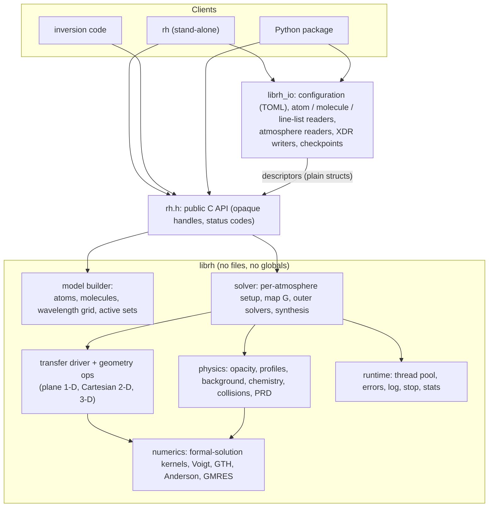
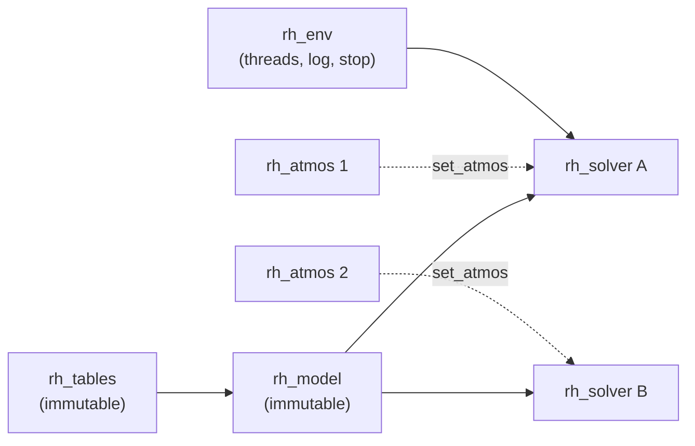
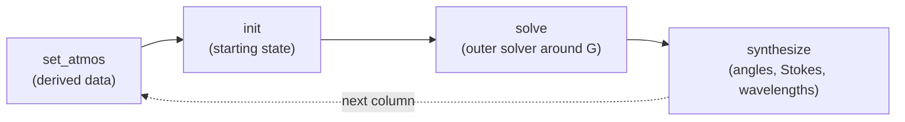
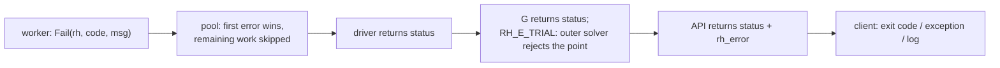
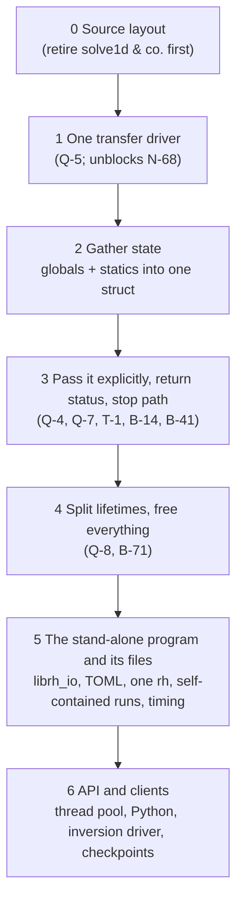

# RH as a library (library track)

Design document for turning RH from four monolithic programs into a library
that a stand-alone program, inversion codes and Python bindings all use. It
records the requirements, the target design, how the current code maps onto
it, and a migration plan that keeps every step verifiable.

- **Status:** accepted 2026-11-24 (#569); revised 2026-11-24 with the
  decisions below, the revision for review. Written against `modernize`
  at `9885adb` (end of plan step 4). Statements about the current code come
  from a survey of that commit, spot-checked against the source; the
  evidence (survey notes, profile) is in
  `/hao/solar1/dwijn/claude/RH/evidence/lib-codemap-profile/`.
- **Companion pages:** the illustrated version of this document,
  <https://claude.ai/artifact/FgTtZN6epAUVuKwE8Si46T>, and the *RH code map*
  (how the code is put together today),
  <https://claude.ai/artifact/UXA2hsvfBEMVFQEzBCLPFW>.
- **Labels used below.** **Decided**: settled with the user. **Proposed**:
  the design as drafted here; changes on review. **Open**: undecided; the
  implementer reports options and measurements rather than choosing
  silently.
- **Decided (user, 2026-11-23):** the core stays in C. The library is
  agnostic of file formats and does not read or write files where it can be
  avoided. MPI stays out, at least for now. The design leaves room for
  response functions. The target design comes first; it may break with the
  current structure where there is a good reason, and the migration reuses
  what fits.
- **Decided (user, 2026-11-24):** the work happens on the integration
  branch `chrysalis` while `modernize` carries on with other work (§6.1).
  The sources move into directories as soon as that is feasible, not at the
  end (phase 0, §6.2). One `rh` program selects its geometry with a
  configuration parameter. The run configuration moves to a structured
  format (F-5). Runs are self-contained: no hard-coded data paths.
  `solve1d`, `solve2d`, `formal2d` and `formal3d` are retired; full backward
  compatibility is not a goal. The stand-alone program gets checkpointing
  (§3.8). Timing and stopping (`PRINT_CPU`, `STOP_RH`) are redone (§3.9).
  What is specific to solar conditions moves out of the library into
  run-time input where that is cheap (§3.10).
- **Decided (user, 2026-11-24, on review):** the breaking changes of §7 as
  proposed. Run-time configuration is preferred wherever it is possible,
  including the checkpoint level (§3.8) and the profiling probes (§3.9).
  TOML for the configuration. Validity limits of built-in data are reported
  only when a run exceeds them (§3.10). A5 of §3.10 is logged as N-69, to be
  fixed on `modernize`.

Contents: §1 the clients and what they need, §2 requirements, §3 the
design (objects, geometry, threads, errors, memory, derivatives,
checkpoints, timing, solar assumptions), §4 the API in outline, §5 how
today's code maps onto it, §6 the branch, the layout and the migration plan,
§7 breaking changes, §8 open questions.

---

## 1. Three clients

| Client | Typical use | What it needs from RH |
|---|---|---|
| **Stand-alone program** (`rh`, today `rhf1d`, `rhsc2d`, `rhsc3d`, `rhsphere`) | One atmosphere per run, the geometry chosen in the configuration; long 2-D and 3-D runs on HPC systems that preempt or time-limit jobs | Every current configuration, with the results of the current programs; a structured configuration; self-contained run directories; checkpoint and restart; file formats handled outside the core |
| **Inversion codes** (STIC-like) | Thousands to millions of 1-D (1.5-D) syntheses per process, same atoms and wavelength grid, a different atmosphere each time; many columns at once on threads; response functions | Set up the atoms and the wavelength grid once; per column: new atmosphere, warm start, solve, emergent spectrum at the observed angles; a failing column returns an error and the process carries on |
| **Python bindings** | Interactive work and scripts: build or load an atmosphere, solve, inspect populations and J, change a keyword, solve again | Arrays in, arrays out; exceptions instead of exits; warnings into Python's logging; interrupt with Ctrl-C; no files left behind |

What the current code does against these needs (from the code map):

- The library defines no global variables, but every program defines eight
  (`atmos`, `spectrum`, `input`, `geometry`, `commandline`, `stats`,
  `messageStr`, `topology`) and the library uses seven of them through
  `extern`; about 60 file-level `static` variables hold the rest.
- About 600 call sites end the process with `exit(70)`.
- Atom arrays are sized with `Nspace` when the atom file is read, and
  `Background()` frees the passive atoms, partition functions and Kurucz
  lines halfway through a run. The wavelength grid depends on whether the
  atmosphere moves and whether it has a magnetic field. So atoms and grid
  cannot be reused for a second atmosphere.
- Nothing is freed at the end of a run (`freeAtmos` and `freeSpectrum` are
  never called), and several static arrays are sized by the first run and
  never reset. A second run in the same process would read stale data.
- Scratch data goes to fixed-name files in the current directory
  (background opacity, PRD weights, `Jgas.dat`, `Imu.dat`), which are never
  removed.
- The four programs each carry a copy of the per-wavelength driver
  `Formal()` (about 300 shared lines each in 1-D, 2-D and 3-D).

---

## 2. Requirements

Each requirement is a test the design and the finished library must pass.

**Cross-cutting**

| ID | Requirement |
|---|---|
| C1 | **No process-wide side effects.** The library never calls `exit`, installs signal handlers, changes the floating-point environment, writes to the current directory, changes stdout/stderr, or keeps mutable global state. |
| C2 | **No file I/O in the core.** Inputs arrive as in-memory data; scratch data lives in memory or in a store the client supplies. Reading and writing RH's file formats is a separate I/O library that clients may use. |
| C3 | **Re-entrant.** Independent solver instances can run at the same time on different threads. Immutable data (physical tables, the model) is shared between them without locks. |
| C4 | **Repeatable.** Create, solve, destroy, any number of times in one process, with no leaks and no state carried over (valgrind and ASan clean). |
| C5 | **Errors return.** Every failure comes back to the caller as a status code and a message; non-convergence is a result, not an error. Warnings go to a callback. |
| C6 | **One library for all geometries.** The geometry is chosen at run time. One per-wavelength transfer driver serves all geometries; geometry-specific code is limited to grids, rays, boundary conditions and ray solvers. |
| C7 | **Deterministic.** The map G stays bit-reproducible at a fixed thread count (as now). Goal: the same results for any thread count. |
| C8 | **Memory trade-offs stay open.** Nothing in the design forces per-thread copies of large arrays or storage of quantities that can be recomputed; plan steps 5 and 6 plug in here. |
| C9 | **C17 with a stable C API.** Opaque handles, a version number, no dependencies beyond libm and POSIX threads in the core (XDR only in the I/O library). |
| C10 | **Testable in pieces.** Every module can be unit-tested without globals. |
| C11 | **Prompt stop.** A stop request ends a solve within seconds (one block of wavelengths) and leaves the solver at its last completed iterate, from which it can continue or be checkpointed. |
| C12 | **Timing built in.** Every solve reports wall-clock and CPU time per stage and its work counts; finer profiling is a compile-time option. |
| C13 | **No built-in solar assumptions.** Properties of the star (abundances and the others of §3.10) come from run-time input; a run that uses built-in data outside its validity range says so. |

**Stand-alone**

| ID | Requirement |
|---|---|
| S1 | Runs every current configuration (1-D, 2-D, 3-D, all keywords that survive §7; spherical symmetry is retired, Q-43) with the results of the current programs, checked with `run_tests.py --exact` at every migration step that should not change results. |
| S2 | Writes its output through the I/O library: RH's XDR files for now, so `rhanalyze` keeps working (a structured output format is open, §8). |
| S3 | Runs too large for memory remain possible through a file-backed store that the program, not the core, provides. |
| S4 | **Self-contained runs.** Every input file is named in the configuration, relative to the run directory or absolute; no hard-coded paths such as `../../Atoms`. |
| S5 | **Structured configuration** (F-5): one file with sections, the geometry selected by a parameter, with a converter from `keyword.input` and its companion files. |
| S6 | **Checkpoint and restart.** On SIGTERM, SIGINT or SIGUSR1, and periodically, the program writes a checkpoint and exits cleanly within the grace period of the batch system (10 minutes on NCAR's `preempt` queue); a restart from it continues the run (§3.8). |

**Inversions**

| ID | Requirement |
|---|---|
| I1 | One model (atoms, molecules, background lines, wavelength grid, options), built once, serves any number of atmospheres. |
| I2 | Per column: set a new atmosphere, start from LTE, from given populations or departure coefficients, or from the previous solution; solve; synthesize. Buffers are reused when the grid size does not change. |
| I3 | Many columns at once: one solver per thread, all sharing one model, with no locks on the hot path. |
| I4 | Synthesis on request: emergent I (and Q, U, V) at the angles the client asks for, with the populations of the NLTE solution, of LTE, or given by the client. |
| I5 | A failing column (bad atmosphere, solver breakdown) returns an error; the solver can be reused for the next column. |
| I6 | Room for response functions (§3.7): explicit state, G as a function of state and atmosphere, Jacobian products and linear solves. |

**Python**

| ID | Requirement |
|---|---|
| P1 | Atmospheres, atom data and options can be given from Python objects and numpy arrays, or read with the I/O library. |
| P2 | Populations, J, rates and spectra are returned as numpy arrays (views where safe, copies otherwise). |
| P3 | Errors become exceptions, warnings go to `logging`, and Ctrl-C stops a solve through the stop callback. |
| P4 | Solves release the GIL. |

---

## 3. Design

### 3.1 Layers



- **Proposed.** The I/O library turns files into the same plain descriptor
  structs that an inversion code or Python fills in directly. The core never
  sees a file name.
- **Proposed.** Keyword parsing is split: the keyword *schema* (names,
  types, defaults, the cross-checks of `readInput`) stays in the core as an
  options object that accepts `set("iteration.limit", "1e-4")`; reading
  the configuration *file* moves to the I/O library. One schema, three front
  ends.
- **Decided: TOML for the configuration** (F-5): tables and arrays of
  tables give the solver blocks and the per-atom options their structure
  (`[solver.anderson]`, `[[atoms]] file = ... active = true`), so most of
  today's keyword conflicts cannot be written at all; no indentation rules;
  a small MIT-licensed C parser can be vendored into `librh_io`. A converter
  turns `keyword.input`, `atoms.input`, `molecules.input` and `ray.input`
  into one file. The geometry is a parameter there
  (`geometry = "1d-plane"`).

### 3.2 Objects and lifetimes

Today the fields of `Atmosphere`, `Atom`, `AtomicLine` and `Spectrum` mix
five lifetimes (code map, *State*). The design gives each lifetime its own
object.

| Object | Holds | Lifetime | Shared? |
|---|---|---|---|
| `rh_tables` | physical data tables: van Hoof Gaunt factors, H⁻ cross-sections, Barklem tables, Kurucz partition functions | process, or as long as any model uses it | yes, immutable, reference-counted |
| `rh_model` | options; atoms and molecules (levels, transitions, collision data parsed into memory, no `Nspace` arrays); abundances; background line lists; Zeeman patterns; the wavelength grid and the active set at each wavelength | built once; immutable | yes, by any number of solvers on any threads; reference-counted |
| `rh_atmos` | topology, grid (heights or column mass or τ, x, y, radii), T, n_e, v_turb, velocities, n_H, optional B, optional boundary radiation | client-owned input; immutable once created | may be reused by several solvers |
| `rh_solver` | everything that changes: geometry built for the atmosphere (rays, stencils, depth scales); derived quantities (LTE populations, collision rates, chemistry, background opacity, profiles); iterated state (populations, J, ρ, n_e); solver history (Anderson); per-worker workspaces; results; statistics; the last error | one per concurrent user; reused across atmospheres | no: one thread at a time |
| `rh_env` | thread pool, log callback, stop callback, user data | as long as the client wants | by solvers used one after another |



- **Proposed: the wavelength grid belongs to the model.** Two model flags,
  *moving* (asymmetric line grids) and *polarized* (Zeeman points for
  polarizable lines), replace today's dependence on `atmos.moving` and
  `atmos.Stokes`. The stand-alone program sets them from the atmosphere
  before building the model, so its results do not change; an inversion sets
  them once. `set_atmos` refuses an atmosphere the model was not built for
  (a moving atmosphere with a static model), with a message, as the keyword
  checks do now.
- **Proposed: per-atmosphere arrays live in the solver.** `nstar`, `n`, `C`,
  `Γ`, `φ`, `ρ`, rates and their per-worker accumulators move out of the
  atom structs into the solver, indexed by atom and transition. Passive
  atoms and partition functions stay in the model, so nothing needs to be
  freed halfway through a run.
- **Proposed: options that change during a run become requests.**
  `adjustStokesMode` (switch to full Stokes for the final solution) becomes
  a field of the synthesis request; the decision that background scattering
  cannot be iterated in a geometry becomes a solver property instead of a
  write to `input.bg_NmaxIter`.

### 3.3 Inside a solver



1. **`set_atmos`**: copy the atmosphere; build the geometry (rays,
   stencils, long characteristics); n_e if asked; LTE populations; collision
   and fixed rates from the model's collision data; chemical equilibrium;
   background opacity at every wavelength (threaded); depth scales that need
   τ at λ_ref (1-D); line profiles (threaded). Option
   `RH_KEEP_STATE` keeps the current populations and J, for warm starts and
   response functions.
2. **`init`**: LTE, zero radiation, populations or departure coefficients
   from the client, or the solver's own previous solution.
3. **`solve`**: the outer solver (Anderson by default, Newton–Krylov,
   fixed point, or the legacy NG loop) around the map G, exactly as
   `solver.c` does today, but on the solver's own state.
4. **`synthesize`**: the final formal solution with populations fixed,
   iterating the background scattering as stage H does today, at the rays
   the request names (the model's rays, or any μ as `solveray` does), with
   or without Stokes. **Open:** synthesis on wavelengths outside the model's
   grid (the observed grid of an inversion) needs active opacity from
   populations at new wavelengths; it is possible but not part of the first
   version.

### 3.4 Geometry as an interface

The 1-D, 2-D and 3-D `Formal()` are one algorithm with a different ray
solver. **Proposed:** one transfer driver in the core does, for each
wavelength, what all four do now (opacity, source function, negative-τ
check, accumulation of J, J20, Jgas, Γ and the rates, background
scattering, emergent intensities), and calls the geometry through a table of
operations:

| Operation | What the geometry provides | Today |
|---|---|---|
| `setup` | rays and weights, stencils, long characteristics, depth scales, from `rh_atmos` and the angle-set options | `MULTIatmos`/`readAtmos` + `fillMesh` + `getAngleQuad(r)` + `getRays` + `convertScales` |
| `rays` | number of rays; direction cosines; integration weights | `geometry.mux/muy/muz/wmu`, sphere `Ray` |
| `vlos` | line-of-sight velocity of each point for each ray | the callback `vproject` |
| `bproject` | cos γ, cos 2χ, sin 2χ of the field for each ray | `Bproject` |
| `solve` | one ray, one direction: I and the diagonal operator Ψ (and the tridiagonal operator where the method has it) from χ and S, with linear or Bézier interpolation | `Piecewise_*`, `ShortChar`, `Feautrier` |
| `solve_stokes` | the same for I, Q, U, V, returning Ψ for I as well | `Piece_Stokes_Bezier3_*` |
| `check_tau` | the negative-optical-depth check with the geometry's columns and quadrature | `negTauColumns` arguments |
| `emergent` | which points are the surface for a ray, and the emergent values there | `I[0]`, top row, top plane |
| `boundary` | incoming intensities at the boundaries for a wavelength | `getBoundary`, `Itop`, `Ibottom` |
| `rii` | the angle-dependent PRD redistribution function for two rays | `RII` |
| capabilities | angle-dependent opacity, Stokes, tridiagonal operator, positive operator | scattered checks (`bgScatterSupported`, `bgScatterLinearFallback`) |

- Polarized and unpolarized transfer differ only in the `solve` operation
  used, so the plumbing of the background-scattering iteration (N-51) comes
  with the shared driver for every geometry. What remains of N-68 is the
  numerics: a positive operator in 2-D and 3-D (linear stencils, or a
  fallback per wavelength as in 1-D), and memory and cost in 3-D. N-67
  remains the question of an operator for the Stokes solver.
- **Decided (2026-11-24): `rhsphere` is retired** (Q-43). The rule was: it
  joins the shared driver if it fits cleanly, otherwise it is retired. Its rays are impact parameter
  rays with a μ and a weight that vary along the ray, and it accumulates Γ
  and the rates itself, under locks. With per-point weights in the driver it
  fits on paper; a prototype after the driver for 1-D, 2-D and 3-D (Q-42)
  decides. It treats static, unpolarized atmospheres with angle-averaged PRD
  only, which limits its use. The evaluation after Q-42 found six paths the
  driver would need for it alone (per-point weights and lengths in J, Γ and
  the rates, one Feautrier solve per ray, the emergent intensity from the
  solver, a τ check over all rays, its own background-scattering sweep,
  refusing the angle-dependent cases), so it does not fit cleanly. A
  spherical geometry can come back later as a table of operations once the
  state is explicit (phase 2 onward).
- **Decided (2026-11-24): the 2-D Eddington approximation is retired**
  (Q-41, §7). It solves each column alone as a 1-D two-stream problem,
  which a loop over columns does with any angle set. In 1-D `SET_EDDINGTON`
  stays: there it is only an angle set (one ray at μ = 1/√3, weight 1), and
  with rays from the configuration it can become a preset (Q-44).
- `Hydrostatic` is not a geometry operation: it changes the atmosphere. It
  stays a 1-D step that only the NG solver allows (§7).
- The indirect call per ray costs nothing measurable: each call does
  O(Nspace) work.

### 3.5 Threads

- **Proposed:** `rh_env` owns a pool of worker threads created once, instead
  of `pthread_create` and `pthread_join` in every `solveSpectrum` call. All
  parallel work goes through it: wavelength blocks (formal-solution sweeps,
  background opacity) and grid-point blocks (profiles, PRD integrals, and
  later the rate equations, P-2).
- Each worker has a workspace allocated once at `set_atmos` (opacity,
  source function, intensity, operator buffers), so the hot loops do not
  allocate (M-8).
- **Proposed: deterministic reductions.** Γ and the rates are accumulated
  per block of wavelengths and merged in block order. With a fixed block
  count the result is the same for any number of threads (C7 goal) and the
  scheduling can be dynamic (P-4). Memory is one accumulator per block in
  flight, the same as today's per-thread copies (M-3). **Open:** the cost of
  the merges for large atoms; measure in phase 6 before making it the
  default.
- **Inversions:** one solver per client thread with a single-threaded env.
  The model is shared read-only, so columns never contend.
- No nested parallelism: a solver's tasks do not start tasks. No
  `pthread_setconcurrency`, no thread attributes in the options.

### 3.6 Errors, warnings, stopping



- **Proposed:** every function that can fail returns an `rh_status`, and
  `Fail` records the code, the routine and the message in the error
  record of the current solver (the first error wins; callers may add
  context on the way up). Functions that cannot fail stay as they are.
  *Agreed 2026-11-26 (phase 3):* a function that can fail and computes a
  value returns the status, and the value through an out-parameter.
- In worker threads the error goes into the worker's slot; the pool stops
  handing out work; the caller gets the error of the lowest-numbered failed
  task, so the report is deterministic.
- An invalid trial point (negative τ, populations or ρ) is the status
  `RH_E_TRIAL`, which the outer solver catches. This generalizes today's
  `negtau.c` flag, which already does exactly this for those cases.
- Non-convergence is reported in `rh_solve_info` (converged, iterations,
  residual, error estimate); the stand-alone program maps it to exit-status
  bit 1 as now.
- Messages and warnings go through `Message(rh, format, ...)` and
  `Warning(rh, routine, format, ...)`, macros over one function,
  `Log(rh, level, routine, format, ...)`. It formats the message (Q-48)
  and writes it, from phase 6 to the env's callback (serialized by the
  env). `Error(rh, level, routine, format, ...)` is for fatal errors
  only: it prints the message and exits, until the errors return
  (Q-51). *Agreed 2026-11-26 (Q-49):* a call that reports no error is
  not named `Error`. `messageStr` is gone (Q-48).
- *Agreed 2026-11-26:* internal and public functions differ. Only the
  API of §4 has `rh_` names; it checks its arguments, never exits or
  aborts, copies the recorded error into the caller's `rh_error`, and is
  all the library exports (`-fvisibility=hidden`). The internal
  functions (`Error`, `Fail`, and all others) take `rh` first and may
  trust what the boundary has checked; only the status codes are
  shared. A broken invariant inside is a bug, not a status:
  `RH_ASSERT` prints the message and aborts, also in Release builds.
- Allocation failure is `RH_E_NOMEM`, not an exit.
- Floating-point traps move to the stand-alone program, which may set
  them around its calls (CI relies on them).
- Stopping is a callback that the transfer driver polls between blocks of
  wavelengths (C11). On a stop the outer solver drops the G evaluation in
  flight and returns `RH_E_STOPPED`, with the solver at its last completed
  iterate. The program sets the flag from a signal handler (§3.8), Python
  from Ctrl-C.

### 3.7 Memory, storage, response functions

**Storage policies (proposed).** The large per-atmosphere arrays get a
policy each, set in the options:

| Policy | Meaning | Use |
|---|---|---|
| `STORE` (default) | kept in memory (single precision where it is now) | everything that fits |
| `RECOMPUTE` | computed when needed, not stored | profiles on the fly (M-1), background for small line lists |
| `CLIENT` | read and written through a store interface the client supplies | the stand-alone program's file-backed store for runs larger than memory (S3) |

Candidates: background opacity, line profiles, PRD weights, hybrid-PRD
tables, Jgas, the angle-dependent intensities of `PRD_ANGLE_DEP`. This is
where plan steps 5 and 6 (M-1, M-4, M-7) plug in without touching the API.

**Response functions (room, not implemented now).** The design keeps the
pieces they need explicit:

1. Synthesis with given populations at a perturbed atmosphere
   (`set_atmos` with `RH_KEEP_STATE`, then `synthesize`): finite-difference
   response functions with fixed populations, at the cost of one formal
   solution.
2. The state vector and G as functions of state and atmosphere: `get_state`,
   `set_state`, `apply_G`.
3. Jacobian-vector products of G (finite differences, as Newton–Krylov
   already does) and a GMRES solve with any right-hand side, which give
   dx/dp = (I − ∂G/∂x)⁻¹ ∂G/∂p at the converged state (implicit function
   theorem), and from it the full NLTE response.

### 3.8 Checkpoint and restart (stand-alone program)

**Why.** Large 2-D and 3-D runs take hours to days, and HPC systems end jobs
early: walltime limits, node failures, preemption. On NCAR's Derecho the
`preempt` queue sends SIGTERM, waits 10 minutes, then sends SIGKILL; a job
can ask to be requeued with `#PBS -r y`
(<https://ncar-hpc-docs.readthedocs.io/en/latest/pbs/preemption/>). One
iteration of a 3-D run can take longer than the grace period (the 3-D perf
case of the log, §2.3: about 44 minutes per iteration), so waiting for the
iteration to end is not enough.

**How (proposed).**

1. The program installs handlers for SIGTERM, SIGINT and SIGUSR1 that only
   set an atomic flag (async-signal-safe). The library installs nothing
   (C1).
2. The solver's stop callback reads the flag. The transfer driver polls it
   between blocks of wavelengths, so the reaction time is one block, not
   one iteration (C11). The outer solver drops the G evaluation in flight
   and returns `RH_E_STOPPED`; its last completed iterate is intact, since
   the Anderson driver already keeps the full state vectors (x, G(x), the
   last accepted point) apart from RH's working arrays.
3. The program writes the checkpoint to a temporary file and renames it
   over the previous one only when it is complete and flushed, so a SIGKILL
   during the write leaves the previous checkpoint usable. It then exits
   with a status that means "stopped, restartable" (proposed: 75,
   `EX_TEMPFAIL`), which a job script can use to requeue.
4. Periodic checkpoints as well, every N iterations or T minutes
   (configuration), so that a kill without warning loses at most that much.
5. A restart (`rh --restart <checkpoint>`) builds model and solver from the
   same configuration, recomputes the derived data (background, profiles),
   checks the checkpoint's identity record, restores the state and continues
   with the remaining iteration budget.

**Contents.**

| Part | Content | Size |
|---|---|---|
| identity | code version and commit, hashes of configuration, model (atoms, grid) and atmosphere | bytes |
| state | the state-vector blocks: populations, ρ, n_e, J (and J20) | J dominates in multi-D: Nspect × Nspace doubles (420 GB in the 256² × 200 estimate of M-5) |
| solver | outer-solver counters and history (Anderson pairs), error-estimate state | (m + 1) pairs of the packed state |

Two levels. **Exact**: everything; the continued run is bit-identical to an
uninterrupted one at the same thread count, which is also the test of the
feature. **Compact**: populations, ρ and n_e; at restart one sweep with the
populations fixed recomputes J and the history starts afresh, which costs a
few iterations and reaches the same solution. Writing 420 GB within 10
minutes needs 0.7 GB/s, so large multi-D runs will want compact checkpoints
on a stop request. The level is a run-time setting, like the rest
(`[checkpoint] level = "exact"` or `"compact"`, for the periodic and the
on-stop checkpoints separately; interval and file name likewise).

The library serializes and restores through client callbacks
(`rh_solver_save`, `rh_solver_restore`), so it still writes no files (C2);
`librh_io` puts the bytes in a file. Today's restarts (`OLD_POPULATIONS`,
`STARTING_J = OLD_J`) become special cases of an initial state read from
files.

### 3.9 Timing and profiling

**Today.** `PRINT_CPU` writes `time.out` from `clock()`, which is CPU time
summed over threads, so it never shows a parallel speedup (P-9); `time.out`
is created in every run, also without `PRINT_CPU`. The work counters of
`work.c` count formal solutions per stage. `STOP_RH` is a file polled once
per iteration.

**Measured** (sundog2, Xeon E5-2697 v2, glibc vDSO):
`clock_gettime(CLOCK_MONOTONIC)` costs 19 ns per call; the CPU-time clocks
(`CLOCK_PROCESS_CPUTIME_ID`, `CLOCK_THREAD_CPUTIME_ID`, `clock()`) cost
about 0.5 µs, a system call each. A wall-clock timer around every
wavelength of a sweep costs 2 × 286 × 19 ns ≈ 11 µs per 49 s sweep of the
profile case, 2 × 10⁻⁷ of it.

**Proposed.**

- Always on, no keyword: wall-clock (monotonic) and CPU time per stage
  (each setup step, each G evaluation, sweeps, PRD, synthesis, output) and
  the work counters, collected in the solver's statistics and returned in
  `rh_solve_info`. The program prints a summary at the end and stores it
  with the results; `time.out` goes.
- Finer probes (per wavelength and per thread, load balance, time spent in
  merges) switched at run time (`[profile] probes = true`). They sit at the
  level of wavelengths and threads, not in inner loops, so the switch costs
  a branch per probe. A compile-time option `RH_PROFILE` (on by default) can
  remove them altogether should a measurement ever show a cost.
- Routine-level profiles come from external tools (perf, VTune, gprof),
  with no code in RH.
- `STOP_RH` goes; signals (Ctrl-C, `kill -TERM`, the batch system) stop a
  run with a checkpoint (§3.8).

### 3.10 Solar-specific assumptions

Asked for by the user on 2026-11-24: whatever is specific to solar
conditions moves out of the library into run-time input, where that is
cheap. A survey of `9885adb` (spot-checked) found no solar constants in the
code: no R☉, no log g = 4.44, no T_eff; gravity and radius come from the
atmosphere file and abundances from the abundance file. What is solar, or
solar-type, is the following.

**Cheap to make run-time input (proposed).**

| # | What | Where | Proposal |
|---|---|---|---|
| A1 | The 1-D reader floors the gas pressure at 1.908 × the electron pressure when it derives n_H from column mass; the number is close to Pg/Pe of fully ionized H and He at solar He/H [inferred] | `rhf1d/multiatmos.c:56,230` | compute it from the abundances |
| A2 | `METALLICITY` scales every element except H, so helium too | `abundance.c:175` | helium as its own parameter, not scaled with the metals (changes results for runs that set `METALLICITY`) |
| A3 | No per-element override: changing one element needs a new abundance file | `abundance.c` | abundances become model data: a base table plus per-element overrides in the configuration (`[abundances] Fe = 7.30`) |
| A4 | The logarithmic scale is recognized from an H entry of exactly 12.00 | `abundance.c:123` | an explicit scale in the configuration |
| A5 | Helium as a collision partner does not follow its own ionization: van der Waals broadening scales the He perturbers with the neutral hydrogen density (A_He · n_HI), and the CO collision rates take all helium as neutral | `broad.c:100-146`, `kurucz.c:791,1139`, `cocollisions.c:96-101` | the neutral He density; logged as N-69, a fix on `modernize` |
| A6 | The default abundance file is solar (Grevesse & Anders 1991, Asplund 2005 C and O) | `Atoms/abundance.input` | data only: offer alternatives |

**Validity limits of built-in data (reported, not configurable).** Kurucz
partition functions cover 1 000–100 000 K and at most stage VI, and are held
at the ends without a warning; molecular equilibrium fits cover
1 000–9 000 K (CO to 12 000 K, H₂O to 6 000 K) and are extrapolated with a
warning (N-53); OH and CH bound-free cover 2 000–9 000 K and 2.1–15 eV;
H₂⁻ free-free θ = 0.5–3.6, H₂⁺ 2 500–12 000 K, H⁻ free-free held below
1 400 K; H₂ Rayleigh scattering stops below 121.6 nm; the linear Stark
broadening of hydrogen is approximate for hot stars; helium bound-free and
free-free opacity need a He model atom, and He⁻ free-free does not exist
(F-8). **Decided:** a run says so only when it uses data outside its range
(C13), with the number of points, as the N-53 warnings already do; the
partition functions, held at the ends without a warning today, get one.

**Structural, not in this track.** The composition is assumed
hydrogen-dominated: abundances are relative to H and n_H is the density
variable; H must be the first atom and H₂ the first molecule; helium is
found by its position in the element table; the van der Waals perturbers
are H and He only; 1-D hydrostatic equilibrium counts electrons only from
metals with model atoms.

**When.** A1 to A4 become model input in phase 4, when abundances move
into `rh_model`; the configuration syntax comes in phase 5. A5 (N-69) is a
physics fix that changes results and does not depend on the library work:
it is fixed on `modernize`. The partition-function warning can go on
`modernize` too.

---

## 4. The API in outline

**Proposed**, to be refined in phase 6. All objects are opaque; every call
that can fail returns `rh_status` and fills a caller-owned `rh_error`.

```c
typedef enum { RH_OK = 0, RH_E_INPUT, RH_E_DATA, RH_E_NUMERIC, RH_E_TRIAL,
               RH_E_NOMEM, RH_E_STOPPED, RH_E_STATE, RH_E_INTERNAL } rh_status;
typedef struct { rh_status code; char where[64]; char message[960]; } rh_error;

/* Options: the keyword schema of readInput, without the file */
rh_status rh_options_create(rh_options **opt, rh_error *err);
rh_status rh_options_set(rh_options *opt, const char *key, const char *value,
                         rh_error *err);

/* Shared, immutable, reference-counted */
rh_status rh_tables_create(const rh_tables_desc *d, rh_tables **t, rh_error *err);
rh_status rh_model_create(const rh_options *opt, const rh_tables *t,
                          const rh_model_desc *d, rh_model **m, rh_error *err);

/* Input */
rh_status rh_atmos_create(const rh_atmos_desc *d, rh_atmos **a, rh_error *err);

/* Runtime */
rh_status rh_env_create(const rh_env_desc *d, rh_env **e, rh_error *err);

/* Solving */
rh_status rh_solver_create(const rh_model *m, rh_env *e, rh_solver **s,
                           rh_error *err);
rh_status rh_solver_set_atmos(rh_solver *s, const rh_atmos *a, unsigned flags,
                              rh_error *err);
rh_status rh_solver_init(rh_solver *s, const rh_init *init, rh_error *err);
rh_status rh_solver_solve(rh_solver *s, const rh_solve_params *p,
                          rh_solve_info *info, rh_error *err);
rh_status rh_solver_synthesize(rh_solver *s, const rh_synth_request *r,
                               rh_spectrum *out, rh_error *err);

/* Results: read-only views, valid until the next call that changes s */
rh_status rh_solver_view(const rh_solver *s, rh_quantity q, int index,
                         rh_array *view);

/* Room for derivatives */
rh_status rh_solver_get_state(rh_solver *s, rh_array *x);
rh_status rh_solver_apply_G(rh_solver *s, const double *x, double *gx,
                            rh_error *err);

/* Checkpoints: bytes through client callbacks, no files */
rh_status rh_solver_save(const rh_solver *s, rh_checkpoint_level level,
                         rh_write_fn write, void *user, rh_error *err);
rh_status rh_solver_restore(rh_solver *s, rh_read_fn read, void *user,
                            rh_error *err);

void rh_solver_destroy(rh_solver *s);   /* and the matching destroy calls */
```

- The descriptors (`rh_atmos_desc`, `rh_model_desc`, `rh_atom_data`, ...)
  are plain structs of sizes and pointers to arrays; the library copies what
  it keeps. The I/O library fills them from files.
- Python: a thin binding over this API (Cython or cffi, decided in phase 6),
  with classes `Tables`, `Model`, `Atmosphere`, `Solver`; result views
  become read-only numpy arrays that keep the solver alive.
- A convenience call for inversions may come later: solve a batch of
  columns on the env's threads, one solver per thread.

---

## 5. From today's code to the design

**Where the globals and statics go**

| Today | Goes to |
|---|---|
| `input` (keywords) | `rh_options` inside the model; the fields changed during a run become solver state or request fields |
| `commandline` | the stand-alone program |
| `atmos`: atoms, molecules, elements, Kurucz lines, abundances | `rh_model` |
| `atmos`: T, n_e, v_turb, n_H, B | `rh_atmos`, copied into the solver (n_e iterated there) |
| `atmos`: background flags and records, cos γ, nH⁻, file descriptors | solver (derived data, in memory) |
| `spectrum`: λ, active sets | `rh_model` |
| `spectrum`: J, J20, Jgas, I, Stokes, file descriptors | solver |
| `geometry` | the solver's geometry object, built by the geometry's `setup` |
| `stats`, work counters, CPU timers | solver statistics, returned in `rh_solve_info`; the program writes `time.out` |
| `messageStr` | error records and stack buffers |
| `topology` | the geometry operations table |
| statics: tables loaded once (Gaunt, H⁻, OH/CH, Wigner, PRD trig tables) | `rh_tables` or constant data, with thread-safe initialization |
| statics: per-run state (solver layout, background scattering, negative-τ record, opacity pool, Kurucz tables, exit flags) | solver |
| statics: I/O (background memory map, XDR streams) | gone (memory) or the I/O library |
| statics: diagnostics | solver statistics |

**What happens to each part of the code**

| Part | Fate |
|---|---|
| Voigt, GTH, Anderson, GMRES, MPE, interpolation, special functions | kept as they are (already pure functions) |
| Formal-solution kernels (piecewise, Bézier, Feautrier, short and long characteristics, stencils) | kept; they take the geometry object and a workspace instead of globals |
| Opacity sources, chemistry, n_e, LTE, collisions, profiles, Zeeman, PRD integrals | physics kept; inputs from model and solver; tables from `rh_tables`; collision data from memory instead of the open atom file |
| `opacity.c`, `fillgamma.c`, `statequil.c` | logic kept; per-worker accumulators instead of `rhth[]` in the atoms |
| `solver.c`, `anderson.c`, `newton.c`, `iterate.c` (NG) | kept; state from the solver object |
| The four `Formal()` | replaced by one driver and four sets of geometry operations |
| `readinput.c`, `readvalue.c` | schema and checks to the core options; file reading to the I/O library |
| Atom, molecule, line-list, B-field and atmosphere readers; all `write*` and restart readers | the I/O library |
| `error.c`, `parallel.c`, `getcpu.c`, `work.c` | rewritten as the runtime (errors, log, pool, statistics) |
| `fpehandler.c`, `stopreq.c` | the stand-alone program |
| `background.c` | split: per-atmosphere stage in the solver; no freeing of model data |

---

## 6. Branch, layout and migration plan

### 6.1 Working on the branch `chrysalis`

**Decided (user, 2026-11-24)**, with the workflow **proposed**:

- All library-track pull requests target `chrysalis`, created on
  2026-11-24 from `modernize` at `d61cf08`. `modernize` carries on with
  fixes and features.
- **Syncing.** `modernize` is merged into `chrysalis` through a pull
  request (branch `sync/modernize-<date>`) whenever it has something the
  library work needs, and at least every few weeks, so that the final merge
  stays manageable. It is reviewed and merged like any code pull request.
- **CI.** Pull requests are already checked against their own base,
  whatever it is (Q-23). Pushes are checked only on `modernize`; the first
  `chrysalis` pull request adds `chrysalis` to the push trigger.
- **Issues and the log.** Each phase gets its log row on `modernize`, as
  usual (a docs PR, then `make_issues.py`). GitHub closes an issue by
  keyword only when the pull request merges into the default branch, so the
  issue of a `chrysalis` pull request is closed by hand with a comment that
  names the pull request; `make_log_page.py` learns to fill in
  "fixed (#n)" from merged `chrysalis` pull requests that say "Closes #N"
  (a docs-tooling change when the first one merges).
- **Change notes** (`docs/changes/<ID>.md`) collect on `chrysalis` and
  reach the changelog when `chrysalis` merges back.
- **The end.** `chrysalis` merges into `modernize` once the library runs
  every configuration with the results of `modernize` (S1) and the other
  requirements pass. If `modernize` has stopped moving by then, `chrysalis`
  simply becomes the main line.
- This document stays on `modernize`, where the design is reviewed; changes
  to it are docs pull requests there.

### 6.2 Phase 0: source layout

*Done 2026-11-24 (#577–#579).*

**Proposed.** The first thing on `chrysalis`, before any code changes: a
pure move (`git mv`, CMake paths, the paths in the unit tests), checked by
`--exact`. Every later phase then works in the final layout. Merges from
`modernize` follow the renames (git's rename detection); conflicts are
expected mainly in `CMakeLists.txt`. Before the move, a separate pull
request retires `solve1d`, `solve2d`, `formal2d` and `formal3d`.

```
src/
  include/     shared internal headers: rh.h, atom.h, atmos.h, spectrum.h,
               inputs.h, constant.h, error.h, statistics.h, background.h, xdr.h
  runtime/     errors, threads, timers and work counters, matrix allocation,
               FP traps and the stop request (until they move to the program)
  numerics/    Anderson, Newton–GMRES, MPE, Ng, GTH, LU, interpolation,
               special functions, quadrature, sorting
  physics/     background opacity sources, chemistry, n_e, LTE, collisions,
               fixed rates, profiles, Voigt, Zeeman, broadening, PRD integrals
  transfer/    opacity per wavelength, Bézier and Stokes kernels, the
               negative-τ detector, background scattering; the driver of phase 1
  nlte/        iteration, the map G and the outer solvers, rate equations and
               Γ accumulation, initial solution, the G checks
  model/       wavelength grid and active sets (the model builder of phase 4)
  io/          configuration and atom/molecule readers, B field, scratch-file
               I/O, XDR writers
  geometry/
    plane1d/   today's rhf1d/, with its main programs for now
    cart2d/    rhsc2d/
    cart3d/    rhsc3d/
    sphere/    rhsphere/ (retired in phase 1, Q-43)
tools/, tests/, docs/, python/, idl/   unchanged
Atoms/, Molecules/, Atmos/             unchanged until runs are self-contained
```

As built (#579, 2026-11-24): the example runs moved from `<program>/run/` to
`examples/<program>/`, and the programs still build into `build/<program>/`.

| Directory | Files today (92 `.c` in the root) |
|---|---|
| `runtime/` (7) | error, parallel, getcpu, work, matrix, fpehandler, stopreq; parallel.h |
| `numerics/` (16) | anderson, newton, mpe, accelerate, maxchange, gth, ludcmp, linear, pchip, hunt, cubeconvol, expint, gammafunc, gaussleg, order, w3; anderson.h, newton.h, mpe.h, accelerate.h, simd.h |
| `physics/` (29) | background, hydrogen, metal, kurucz, rayleigh, thomson, ohchbf, chemequil, solvene, nemetals, ltepops, collision, cocollisions, fixedrate, profile, voigt, zeeman, molzeeman, paschen, broad, barklem, planck, wigner, giigen, scatter, prdfold, prdh, prdrho, vacuumtoair; prdfold.h, prdh.h, atomweights.h |
| `transfer/` (6) | opacity, bezier_aux, stokesgrid, stokesopac, negtau, bgscatter; bezier.h, stokesgrid.h, negtau.h, bgscatter.h |
| `nlte/` (8) | iterate, solver, statequil, fillgamma, initial_xdr, initscatter, redistribute, gchecks; solver.h |
| `model/` (3) | sortlambda, getlambda, duplicate |
| `io/` (23) | readinput, readvalue, parse, options, getline, abundance, readatom, readmolecule, readb_xdr, readj, pops_xdr, radrate_xdr, brs_xdr, backgropac_xdr, writeatmos_xdr, writeatom_xdr, writecoll_xdr, writedamp_xdr, writeinput_xdr, writemetal_xdr, writemolec_xdr, writeopac_xdr, writespect_xdr |

Files that mix concerns go where most of their code belongs and are split in
later phases: `readatom.c` reads atom files and builds model data (split in
phase 4), `initial_xdr.c` sets up the initial solution and reads old
populations and J (split in phase 5), `background.c` is the per-atmosphere
background stage and frees model data (phase 4). `librh.a` stays one
library until phase 5 separates `librh_io`.

### 6.3 Phases

**Proposed.** Seven phases. Each pull request keeps results unchanged
(`run_tests.py --exact` against its base, full `ctest`, icx) unless it says
otherwise and carries `changes-results`.



0. **Source layout** (§6.2), after retiring `solve1d`, `solve2d`,
   `formal2d` and `formal3d`.
1. **One transfer driver.** Move the per-wavelength driver into the
   library; each program installs its geometry operations. Globals stay for
   now. Settles the riskiest interface first, removes two of the three
   copies of the driver (about 600 lines), and opens the way for N-68.
   In three steps: retire the 2-D Eddington branch (Q-41); one driver for
   1-D, 2-D and 3-D, with `rhsphere` behind an override (Q-42); then
   `rhsphere` is retired (Q-43, §3.4: it does not join cleanly).
   *Done 2026-11-25 (#584, #585, #588).*
2. **Gather state.** Put the eight globals and the per-run statics into one
   struct with one global instance; references are rewritten mechanically
   (`atmos.T` becomes `rh->atmos.T` with `rh` the global instance). Nothing
   else changes, so `--exact` checks the rewrite.
   *Agreed 2026-11-25 (survey: `claude/RH/evidence/lib-phase2-survey`):*
   the struct is `RHState` (`src/include/state.h`), reached through
   `RHState *const rh`; each program defines the instance with a static
   initializer, and `geometry` is a pointer, since its type differs per
   geometry. Two pull requests: the seven globals, rewritten by a script
   (Q-45), then the 36 per-run statics by hand, one part of the struct per
   module (Q-46). `messageStr` waits for phase 3, the 27 tables loaded once
   for phase 4, the 13 scratch buffers for phase 3 and the 5 file handles
   for phase 5.
   *Done 2026-11-25 (#594, #595). As built: the module parts' types were
   declared by hand and the uses of the statics rewritten by a script, as
   for the globals; the opacity buffer pool moved with them (37 variables).*
3. **Pass it explicitly, return status, stop path.** Module by module,
   leaves first: the struct pointer becomes the first parameter, and
   functions that can fail return `rh_status` instead of calling
   `Error(ERROR_LEVEL_*)`. Both touch the same signatures, so they go
   together. At the end the global instance is gone and no code path exits;
   the stop callback is polled between wavelength blocks (C11). Most of the
   ~600 fatal call sites are input checks in `readinput.c`, `readatom.c` and
   `readmolecule.c`, where returning is natural.
   *Agreed 2026-11-26 (survey and proposal: `claude/RH/evidence/lib-phase3-survey`):*
   446 functions need `rh` and 275 can fail, at 390 fatal sites. Five
   steps, each with results unchanged: messages with format arguments,
   `messageStr` removed (Q-48); `rh` the first parameter of the 446
   functions in one generated sweep, and the global removed (Q-49); the
   statics left (Q-50); errors that return, by hand, module by module
   from the leaves, with a macro that exits as today in callers not yet
   converted (Q-51, and a row per later module group); the stop path
   (Q-52). So the parameter and the status returns are no longer done
   together (below). A function that can fail and computes a value
   returns it through an out-parameter. The fatal sites are classified
   first, and broken invariants become `RH_ASSERT` instead of statuses
   (§3.6). Internal functions keep internal names; `rh_` is for the API
   of phase 6. `ERROR_LEVEL_1` stays fatal; Q-16 follows phase 3.
4. **Split lifetimes and free everything.** Model, atmosphere and solver
   become separate objects (§3.2): atom data without `Nspace` arrays,
   collision data parsed into memory, `Background()` no longer frees model
   data, grid flags from the options, a complete free path (fixing B-71 on
   the way). The solar-specific values of §3.10 become model input here. New
   test: two solves in one process give the same results as two processes,
   and valgrind/ASan are clean.
   Known to break that test (survey of phase 2): counters never reset
   between runs (G evaluations; `ne_iter` in `computeBackground`, so a
   second run would not solve n_e from scratch; the PRD damping note; the
   exit flags), the opacity pool sized once from the thread count, the
   background-scattering arrays sized once from the number of wavelengths,
   and the solver's arrays, which are never freed.
5. **The stand-alone program and its files.** `librh_io` separates from the
   core; background opacity, PRD weights, Jgas and the angle-dependent
   intensities live in memory with the storage policies of §3.7. One `rh`
   program with the geometry from the configuration; the TOML configuration
   with its converter (F-5); every path from the configuration (S4); the
   statistics of §3.9 replace `time.out` and `PRINT_CPU`. Results unchanged;
   the output files stay byte-identical.
6. **API and clients.** The public `rh.h`; the env thread pool; Python
   bindings; an inversion-style test driver (many columns, one solver per
   thread, shared model) that exercises C3, C4 and I1 to I5; checkpoint and
   restart in `rh` (§3.8, tested by bit-identical continuation);
   block-ordered reductions (`changes-results`).

Why this order:

- The layout costs least before anything else is in flight on the branch.
- The geometry interface is the part most likely to need a second try, and
  it is self-contained; doing it early shrinks the code every later phase
  touches.
- Gathering before threading separates a mechanical rename from the
  signature changes, and each is checked by `--exact` on its own.
- Error returns and the explicit context change the same function
  signatures; doing them together touches each function once. (The order
  agreed on 2026-11-11 put Q-7 first; on its own it would need a place for
  error state and would touch every signature twice.) *Revised
  2026-11-26:* the parameter comes first, in one generated sweep, and the
  returns by hand after it. A generated first touch costs little, and a
  parameter added module by module would sit beside the global of the
  same name, which a missed function would silently use.
- Lifetimes can only be split once the state is explicit; files can only
  leave the core once each array has an owner; the API comes last because
  it exposes all of it.

After phase 6, separately: N-67 and N-68 on the shared driver, response
functions, synthesis on other wavelength grids, then plan steps 5 and 6.

New log items: each phase gets a log row (and issue) before its first pull
request, as usual; Q-4, Q-5, Q-7, Q-8, Q-9, Q-16, T-1, T-2, T-3, B-14, B-41,
B-71 and F-5 close along the way.

---

## 7. Breaking changes

Full backward compatibility is not a goal; the proposals below were agreed
on review (user, 2026-11-24).

| Item | Decision | Reason |
|---|---|---|
| Program names | **Decided:** one `rh` program; the geometry is a configuration parameter | one library, one program |
| `keyword.input`, `atoms.input`, `molecules.input`, `ray.input` | **Decided:** one structured configuration file in TOML (F-5), with a converter | structure the flat files cannot show; most keyword conflicts become impossible to write |
| Hard-coded paths (`../../Atoms/...`) | **Decided:** none; every input named in the configuration, relative to the run directory or absolute | self-contained runs |
| `solve1d`, `solve2d`, `formal2d`, `formal3d` | **Decided:** retire (before phase 0) | own `Iterate`, binary stdin protocols |
| `LIMIT_MEMORY` | **Decided:** drop | replaced by storage policies; NG only today |
| `OLD_BACKGROUND`, `BACKGROUND_FILE` | **Decided:** drop from the core; the program may offer saving and loading the background | the background lives in memory |
| `STARTING_J = OLD_J`, `J_FILE`, `OLD_POPULATIONS` | **Decided:** restarts in the program, which reads the files and passes the state to `init`; checkpoints generalize them | restart is a client feature |
| `STOP_RH` | **Decided:** replaced by signals, which stop with a checkpoint (§3.8) | process-level behaviour |
| `PRINT_CPU`, `time.out` | **Decided:** always-on stage statistics, finer probes switched at run time (§3.9) | the current timer is CPU time summed over threads |
| `METALLICITY` | **Decided:** no longer scales helium; helium is its own parameter (§3.10, A2) | a solar mixture assumed |
| `brs.out`, `metals.out`, `molecules.out` | **Decided:** written only when asked | analysis output, written in every run today |
| 2-D `ANGLE_SET = SET_EDDINGTON` | **Decided:** retire (before phase 1, Q-41); 1-D keeps it | each column solved alone as 1-D two-stream, which a loop over columns gives |
| `rhsphere` | **Decided:** retire (phase 1, Q-43); it does not fit the shared driver cleanly | static, unpolarized, angle-averaged PRD only; six special paths in the driver |
| `HYDROSTATIC` | **Decided:** a 1-D step of the NG solver | changes the atmosphere; a block in G is a later question |
| `N_THREADS` | **Decided:** an env setting; the configuration sets it for `rh` | threads are a runtime property |

---

## 8. Open questions

1. *Settled 2026-11-24:* `rhsphere` does not join the shared transfer
   driver cleanly and is retired (Q-43, §3.4).
2. Block-ordered reductions (§3.5): default, option, or dropped, after
   measuring the merge cost for large atoms.
3. Synthesis on wavelengths outside the model's grid (§3.3): when, and with
   which opacities.
4. Cython or cffi for the Python binding.
5. Reference counting of tables and models, or the documented rule that a
   model outlives its solvers.
6. Output and checkpoint format of the stand-alone program: RH's XDR
   files, or a structured format (HDF5, netCDF). The library does not care;
   `rhanalyze` would need a reader for a new format.
7. Which TOML parser to vendor (TOML itself is decided), and whether the
   converter from `keyword.input` lives in C (`rh --convert`) or Python.
8. Where `Atoms/`, `Molecules/` and `Atmos/` live once runs are
   self-contained (a `data/` directory?).
9. A file-based stop as a convenience where signals do not reach the job.
